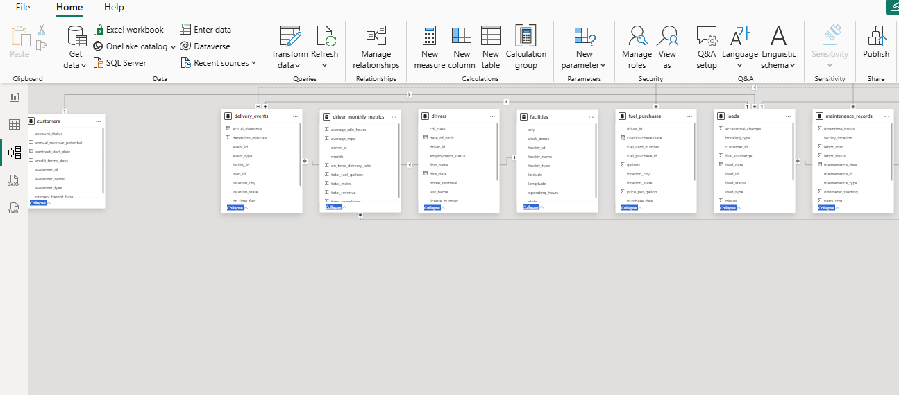
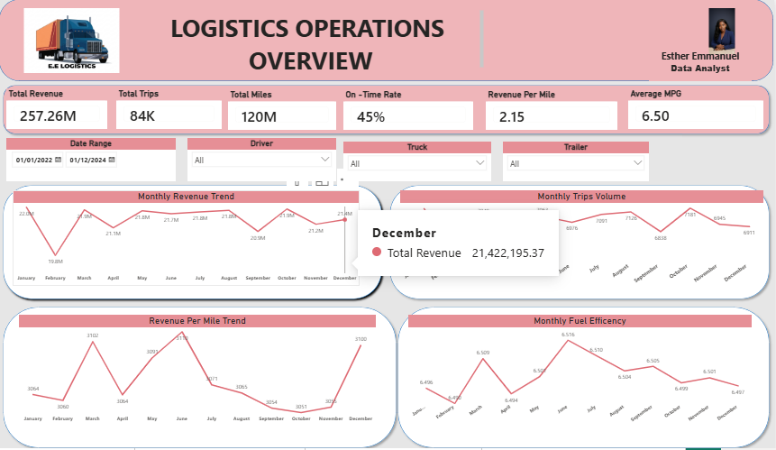
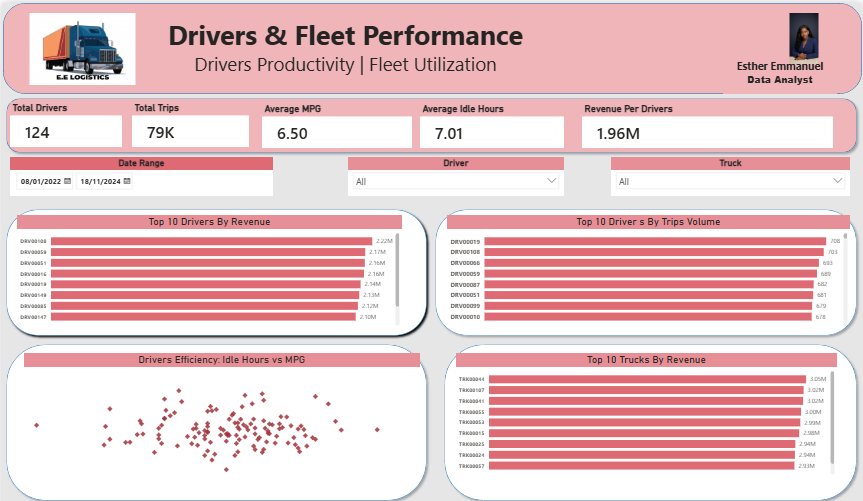
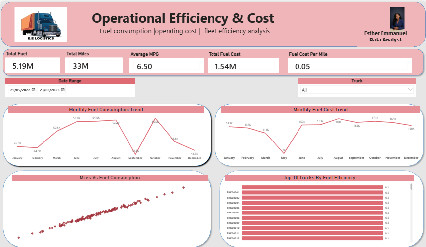
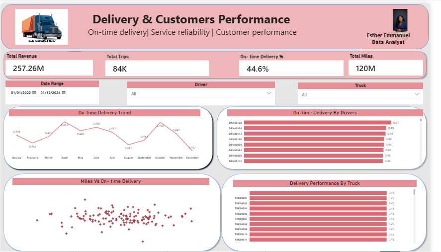

# Logistics Operations Performance & Efficiency Analysis

**A Power BI Data Analytics Project**

## Project Overview

This project focuses on analysing logistics operations using Microsoft Power BI. It explores key areas of operational performance, driver and fleet efficiency, fuel consumption, operating costs, delivery performance and customer service.

The goal is to transform operational data into meaningful insights that can help stakeholders monitor business performance, identify operational inefficiencies and make informed decisions.

The project involves data preparation, data cleaning, data modelling, DAX calculations and interactive dashboard development. ## 📊 Dashboard Preview

The Power BI report consists of four interactive dashboard pages, each designed to examine a different aspect of logistics operations.

| Executive Operations Overview | Drivers & Fleet Performance |
|---|---|
|  |  |
| **Operational Efficiency & Cost** | **Delivery & Customer Performance** |
|  |  |

*Click any dashboard image to view the full-size screenshot.*
### Tools & Technologies
- Microsoft Power BI
  - Power Query for data cleaning and transformation
  - DAX for measures and calculations
  - Data Modelling for establishing relationships between tables
  - Interactive visualisations for performance monitoring
## Business Problem

Logistics companies manage several operational activities, including transportation, driver performance, fuel consumption, delivery schedules and operating costs.

Without a clear view of these activities, management may find it difficult to monitor operational performance, identify inefficiencies, control costs and evaluate delivery reliability.

This project addresses the need for a centralised performance monitoring solution by using Power BI to analyse logistics data and present key operational metrics through interactive dashboards.

## 🎯 Business Goal

The goal of this project was to develop an interactive Logistics Operations Performance Dashboard using Microsoft Power BI to provide a comprehensive view of logistics activities.

The dashboard was designed to help management:

- Monitor overall logistics operational performance.
- Evaluate driver and fleet performance.
- Analyse fuel consumption and operating costs.
- Track delivery performance and service reliability.
- Identify operational inefficiencies and areas for improvement.
- Support data-driven decision-making through interactive visualisations.

## ❓ Business Questions

This project was designed to answer the following business questions:

### 1. Executive Operations Overview
- What is the overall operational performance of the logistics business?
- What is the total revenue generated?
- How many trips were completed?
- What is the total distance covered?
- What percentage of deliveries were completed on time?
- How does operational performance change over time?

### 2. Drivers & Fleet Performance
- Which drivers generate the highest revenue?
- Which drivers complete the highest number of trips?
- How efficient are drivers in terms of fuel consumption and idle hours?
- Which trucks generate the highest revenue?
- How does driver performance vary across the reporting period?

### 3. Operational Efficiency & Cost
- How much fuel is consumed across operations?
- What is the total fuel cost?
- How does fuel consumption change over time?
- What is the relationship between distance travelled and fuel consumption?
- Which trucks demonstrate better fuel efficiency?
- What is the fuel cost per mile?

### 4. Delivery & Customer Performance
- What percentage of deliveries are completed on time?
- How does on-time delivery performance change over time?
- Which customers account for the highest logistics activity or revenue?
- Are there differences in delivery performance across customers?
- What areas require improvement to enhance service reliability?

## 📂 Dataset Description

The logistics dataset consists of 14 CSV files containing operational information related to customers, drivers, fleet activities, facilities, trips, revenue, fuel consumption and delivery performance.
The original CSV files are not separately included in this repository. The Power BI project file is provided to demonstrate the report and its analytical implementation.
## 📊 Data Dictionary

The logistics dataset contains 14 related tables. Each table provides information about a specific area of the business and supports the analysis of logistics operations.

The following tables and columns have been identified so far:

| Table | Description | Key Columns |
|---|---|---|
| Customers | Contains customer-related information. | To be verified |
| Drivers | Stores driver details, employment information and experience. | driver_id, first_name, last_name, hire_date, termination_date, employment_status, cdl_class, years_experience |
| Driver Monthly Metrics | Contains monthly driver performance and operational metrics. | driver_id, month, trips_completed, total_miles, total_revenue, average_mpg, total_fuel_gallons, on_time_delivery_rate, average_idle_hours |
| Facilities | Contains information about logistics facilities and locations. | To be verified |

The remaining tables and their columns will be documented after reviewing the Power BI data model to ensure accuracy.

The datasets were imported into Microsoft Power BI, where Power Query was used for data preparation and transformation. The tables were then organised within the Power BI data model to support analysis across different areas of logistics operations.

The dataset provides the foundation for evaluating operational performance, driver productivity, fleet efficiency, fuel consumption, operating costs and delivery performance.

## 🧹 Data Preparation

Data preparation was carried out in Microsoft Power BI using Power Query to improve data consistency and prepare the datasets for analysis.

The preparation process included:

- Imported the 14 CSV files into Power BI.
- Inspected the tables and reviewed their columns.
- Checked for missing values in important identifier fields, including Driver ID, Truck ID and Trailer ID.
- Reviewed and adjusted data types to ensure fields were suitable for analysis.
- Set numerical fields such as trips completed and total miles to whole number data types.
- Set financial and performance fields, including total revenue, average MPG, fuel consumption and delivery rates, to appropriate decimal data types.
- Reviewed date fields to ensure they could support time-based analysis.
- Prepared the tables for relationships within the Power BI data model.

These preparation steps helped establish a consistent foundation for the development of the logistics performance dashboard.

## 🔗 Power BI Data Model

The 14 CSV datasets were brought into Microsoft Power BI, where a data model was developed to support analysis across different areas of logistics operations.

Relationships were established between relevant tables using common identifier fields to enable information to be analysed across the dataset.

The data model supports the analysis of:

- Driver performance and monthly operational metrics.
- Fleet performance and vehicle efficiency.
- Customer and facility information.
- Revenue, fuel consumption and delivery performance.

The model provides the foundation for creating DAX measures, calculating key performance indicators (KPIs) and developing interactive dashboard pages.

### Power BI Data Model

The data model shows how the tables in the logistics dataset are connected within Power BI. These relationships support analysis across the different operational areas.

## 📊 Power BI Implementation

Microsoft Power BI Desktop was used to develop an interactive Logistics Operations Performance Dashboard.

The implementation process involved:

- Importing the 14 CSV datasets into Power BI.
- Preparing and transforming the data using Power Query.
- Reviewing data types and handling data-quality issues.
- Establishing relationships between relevant tables in the Power BI data model.
- Creating DAX measures to calculate key performance indicators (KPIs).
- Developing interactive visualisations to analyse logistics operations.
- Applying slicers and filters to allow users to explore performance across different dimensions.
- Organising the report into four dashboard pages to support different areas of business analysis.

The dashboard provides a centralised view of logistics performance and enables users to explore operational metrics through interactive reports.

## 📈 DAX Measures

DAX (Data Analysis Expressions) was used in Power BI to create measures for calculating key performance indicators (KPIs) and evaluating logistics operations.

The measures support the analysis of revenue, trip volume, distance covered, fuel consumption, driver productivity and operational efficiency.

Some of the measures created include:

- Total Revenue
- Total Trips
- Total Miles
- Total Fuel Consumption
- Average MPG
- Average Idle Hours
- Revenue per Driver
- Revenue per Mile
- On-Time Delivery Rate

These measures provide management with an overview of operational performance and support comparisons across different dashboard pages.

## 🎨 Dashboard Design

The Logistics Operations Performance Dashboard was designed to provide a clear and interactive view of business performance.

The design focused on presenting important operational metrics in a structured and user-friendly format.

To improve readability and user experience:

- KPI cards were used to display important performance indicators.
- Charts were selected based on the business questions being investigated.
- Slicers and filters were incorporated to allow users to explore data across different dimensions.
- Related metrics and visualisations were organised into separate dashboard pages.
- Consistent formatting was applied to improve readability and maintain a unified dashboard appearance.
- Visualisations were arranged to help users move from high-level performance monitoring to more detailed operational analysis.

## 🏠 Executive Operations Overview

The Executive Operations Overview provides a high-level summary of the logistics business's overall operational and financial performance.

It enables management to monitor key performance indicators and identify important operational trends.

### Key Performance Indicators (KPIs)
- Total Revenue
- Total Trips
- Total Miles
- Revenue per Mile
- On-Time Delivery Rate
- Average MPG

### Key Visualisations
- Monthly operational performance trends
- Revenue performance
- Delivery performance
- Fuel efficiency overview

The page provides management with a centralised view of important business metrics, supporting quick performance assessment and further investigation of operational activities.

## 🚚 Drivers & Fleet Performance

The Drivers & Fleet Performance page evaluates driver productivity and vehicle performance across logistics operations.

It provides insights into driver contributions, trip completion, revenue generation and operational efficiency.

### Key Performance Indicators (KPIs)
- Total Drivers
- Total Trips
- Average MPG
- Average Idle Hours
- Revenue per Driver

### Key Visualisations
- Top 10 Drivers by Revenue
- Top 10 Drivers by Trip Volume
- Driver Efficiency: Idle Hours vs MPG
- Top 10 Trucks by Revenue

### Interactive Filters
- Date Range
- Driver
- Truck

This page enables management to compare driver performance, monitor fleet productivity and identify opportunities to improve operational efficiency.

## ⛽ Operational Efficiency & Cost

The Operational Efficiency & Cost page analyses fuel consumption, mileage and fuel-related expenses across logistics operations.

The page helps identify fuel usage patterns, monitor operational costs and evaluate the relationship between distance travelled and fuel consumption.

### Key Performance Indicators (KPIs)
- Total Fuel
- Total Miles
- Average MPG
- Total Fuel Cost
- Fuel Cost per Mile

### Key Visualisations
- Monthly Fuel Consumption Trend
- Monthly Fuel Cost Trend
- Miles vs Fuel Consumption
- Top 10 Trucks by Fuel Efficiency

### Interactive Filters
- Date Range
- Truck

This page supports management in monitoring fuel efficiency, identifying cost patterns and evaluating opportunities to reduce operational expenses.

## 📦 Delivery & Customer Performance

The Delivery & Customer Performance page evaluates delivery reliability and customer-related logistics activities.

It helps management understand delivery performance, monitor customer-related activities and identify areas that may require operational improvement.

### Business Questions
- What percentage of deliveries are completed on time?
- How does on-time delivery performance change over time?
- Which customers account for the highest logistics activity or revenue?
- Are there differences in delivery performance across customers?
- What areas require improvement to enhance service reliability?

### Key Performance Indicators (KPIs)
- On-Time Delivery Rate
- [Add the other KPIs displayed on the actual dashboard]

### Key Visualisations
- [Add the actual delivery performance charts]
- [Add the actual customer performance charts]

### Interactive Filters
- [Add the slicers displayed on the actual dashboard]

This page supports the evaluation of delivery reliability and customer performance, providing information that can help management improve service quality and operational efficiency.

### 1. Executive Operations Overview
- [Document the most important revenue and operational performance findings.]
- [Identify any significant trends in trips, mileage or delivery performance.]

### 2. Drivers & Fleet Performance
- [Identify drivers with the highest revenue or trip contributions.]
- [Highlight important differences in driver and truck performance.]

### 3. Operational Efficiency & Cost
- [Describe fuel consumption and fuel cost patterns.]
- [Identify differences in fuel efficiency across trucks, where supported by the data.]

### 4. Delivery & Customer Performance
- [Highlight the on-time delivery performance.]
- [Identify important customer performance patterns.]

These insights provide a basis for understanding operational performance and identifying areas that may require management attention.

---
## 💡 Key Insights

The Power BI dashboard provides insights into logistics operations across four key areas.

### 1. Executive Operations Overview
- Total revenue generated: [Insert verified value].
- Total trips completed: [Insert verified value].
- Total distance covered: [Insert verified value].
- On-time delivery rate: [Insert verified value].

### 2. Drivers & Fleet Performance
- Highest revenue-generating driver: [Insert verified result].
- Driver with the highest trip volume: [Insert verified result].
- Fleet performance observation: [Insert verified result].

### 3. Operational Efficiency & Cost
- Total fuel consumption: [Insert verified value].
- Total fuel cost: [Insert verified value].
- Fuel efficiency observation: [Insert verified result].

### 4. Delivery & Customer Performance
- On-time delivery performance: [Insert verified result].
- Highest revenue-generating customer: [Insert verified result].
- Customer delivery performance observation: [Insert verified result].

These findings highlight important areas of logistics performance and provide a basis for operational recommendations.
## 
## 📌 Business Recommendations

The following recommendations represent potential actions that logistics management could consider when reviewing operational performance.

1. **Improve Driver Performance Monitoring:** Regularly review driver productivity, trip completion and operational efficiency to identify areas requiring improvement.

2. **Monitor Fleet Efficiency:** Evaluate truck performance to identify vehicles that may require maintenance or further operational assessment.

3. **Control Fuel Expenses:** Monitor fuel consumption and fuel-related costs to identify unusual spending patterns and opportunities to improve efficiency.

4. **Improve Delivery Reliability:** Monitor on-time delivery performance and investigate factors contributing to delivery delays.

5. **Strengthen Customer Performance Monitoring:** Evaluate customer-related logistics activities to identify opportunities to improve service quality.

6. **Support Data-Driven Decision-Making:** Use the Power BI dashboard for regular performance reviews and operational planning.

These recommendations should be prioritised according to the verified findings and the operational needs of the business.
## ⚠️ Project Challenges

During the development of this project, several challenges were encountered during data preparation, modelling and dashboard development.

- **Missing Values:** Missing values were identified in some important identifier fields, including Driver ID, Truck ID and Trailer ID. These required review during data preparation.
- **Data Type Consistency:** Different data types had to be reviewed and adjusted to make the fields suitable for analysis.
- **Data Modelling:** Establishing relationships between the different datasets required careful consideration of common identifier fields.
- **DAX Calculations:** Developing operational and financial measures required attention to calculation logic and filter context.
- **Visualisation Accuracy:** Some visualisations required additional checks to ensure that their results accurately represented the underlying data.

These challenges highlighted the importance of data quality, appropriate modelling and validation when developing Power BI dashboards.

## 📚 Lessons Learned

Working on this project improved my understanding of how Power BI can be used to transform operational datasets into meaningful business information.

The key lessons learned include:

- Using Power Query to prepare and transform multiple datasets.
- Understanding the importance of data quality and consistent data types.
- Establishing relationships between tables within a Power BI data model.
- Creating DAX measures to calculate key performance indicators.
- Selecting appropriate visualisations based on business questions.
- Using slicers and filters to support interactive data exploration.
- Interpreting dashboard results and connecting analytical findings to business decisions.
- Understanding the importance of validating calculations and visual outputs before presenting insights.

The project also strengthened my ability to approach data analysis from a business perspective rather than focusing only on creating visualisations.

---

## 🚀 Future Improvements

The project can be extended through the following improvements:

- Incorporating more detailed delivery delay analysis.
- Developing predictive models for delivery performance and operational planning.
- Introducing more detailed fuel cost and consumption monitoring.
- Expanding customer performance analysis.
- Improving fleet maintenance monitoring.
- Including additional operational data to support more detailed comparisons.
- Enhancing the dashboard with further interactive reporting features.

These improvements could provide additional analytical capabilities and support more comprehensive logistics performance monitoring.

---

## 👩‍💻 Author

**Esther Ohuenene Emmanuel**

Junior Data Analyst | Power BI | Excel | SQL | Python

This project demonstrates my practical experience in using Microsoft Power BI for data preparation, data modelling, DAX calculations, interactive visualisation and business performance analysis.

- **GitHub:** [NENE-202](https://github.com/NENE-202)
- **LinkedIn:** [Esther Emmanuel](https://www.linkedin.com/in/esther-emmanuel7/)

